# retrobox-core

A port of the [batocera](https://github.com/batocera-linux/batocera.linux) backend stack to a standard Linux desktop (Debian, Ubuntu or Fedora; KDE Plasma, wlroots compositors or X11), using `batocera-configgen` as a base.

The goal is to have a batocera/Retrobat-like experience if paired with [retrobox-emulationstation](https://github.com/RetroboxProject/retrobox-emulationstation), a build of batocera-emulationstation, featuring automatic emulator configuration, bezels, shaders, controller mapping — without having to reboot to other OS.

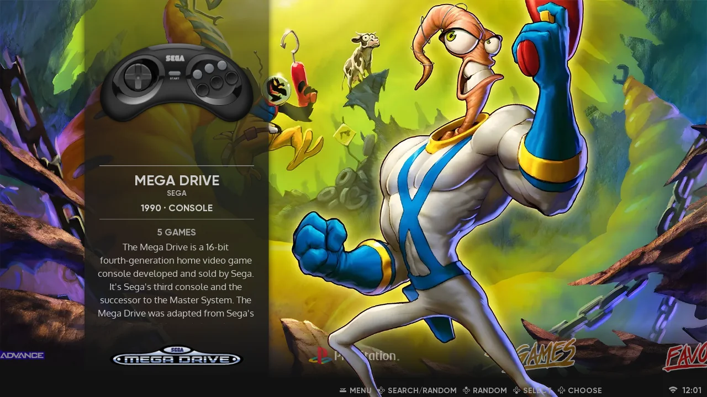

## Motivation

Batocera is excellent as a dedicated gaming system, but it needs to be booted as a whole OS. A few years ago, I discovered Retrobat, but it is Windows-only (there are some ways to run it on Linux with Wine/Lutris, but not all emulators work). RetroDeck, EmuDeck and ES-DE doesn't have all the goodies Retrobat and Batocera have, such as auto gamepad config (the most important thing for me).

This project brings the parts that matter most to a desktop Linux installation:

- `batocera-configgen` writing emulator configs automatically on game launch
- Bezels: RetroArch draws them itself; the other emulators get them through a patched MangoHud build, the same approach batocera uses.
- Shaders on RetroArch and ares.
- Controller autoconfiguration for RetroArch, ares, Azahar, Cemu, Dolphin, Eden, Flycast, MAME, melonDS, PCSX2, PPSSPP, Redream, RPCS3, Ryujinx, ScummVM, shadPS4, Vita3K, Kodi and Keisho (Sega Model 1, 2 and 3).
- Gamepad hotkeys (Hotkey+Start to exit, etc.) on every emulator through the input daemon of [retrobox-overlay](https://github.com/RetroboxProject/retrobox-overlay).

## Screenshots

| | |
|---|---|
| 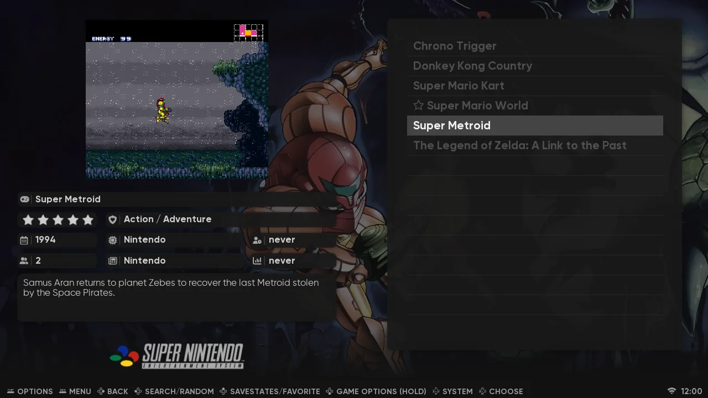 | 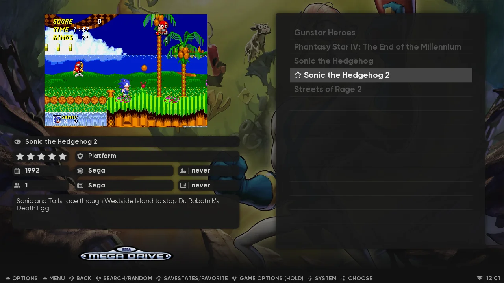 |
| **Game lists** with scraped media, ratings and metadata. | Every system keeps the theme's look and its own artwork. |
| 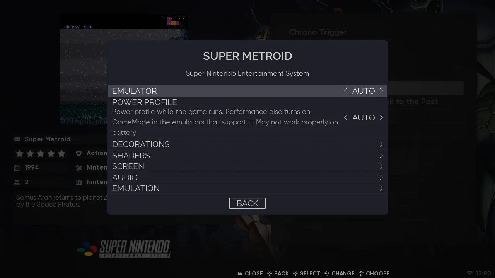 | 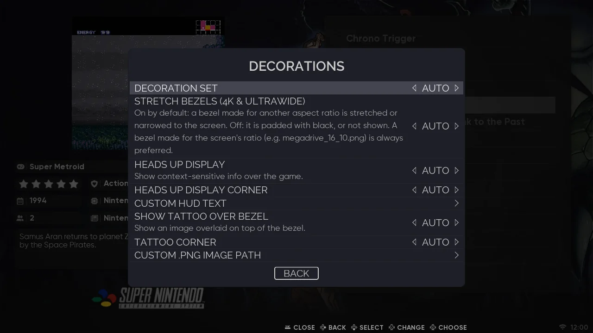 |
| **Per-game options**: emulator, power profile, decorations, shaders, screen, audio and emulation, built from `share/emulator_options/` (see [Systems and emulator options](#systems-and-emulator-options)). | **Decorations**: bezel set, stretching, HUD and tattoo, for RetroArch and (through MangoHud) the other emulators. |
| 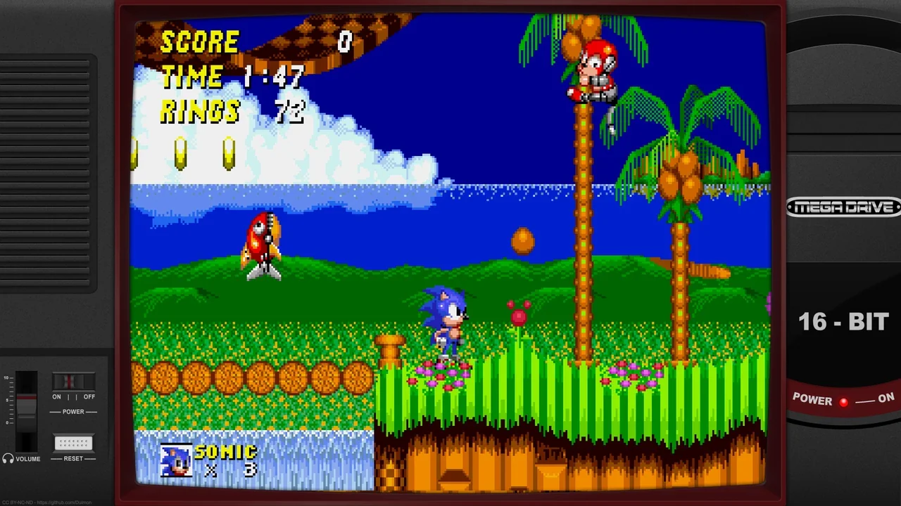 | 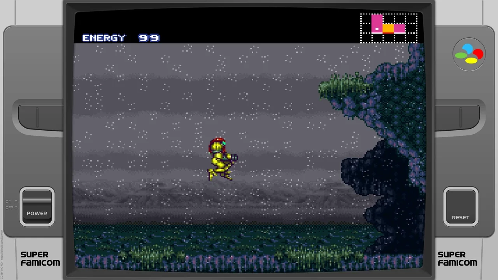 |
| **Bezels** from the RetroBat set, downloaded on the first start (see [Bezels and aspect ratios](#bezels-and-aspect-ratios)). | The game is fitted to the bezel's viewport from its `.info` file. |
| 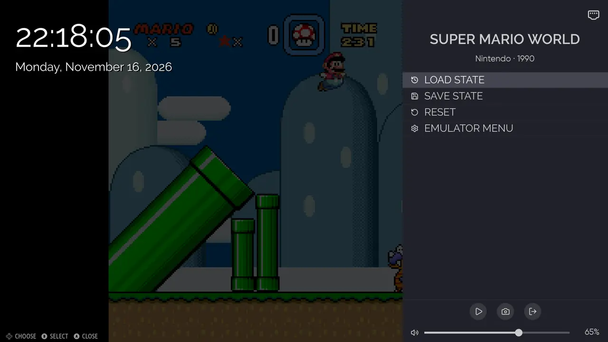 | 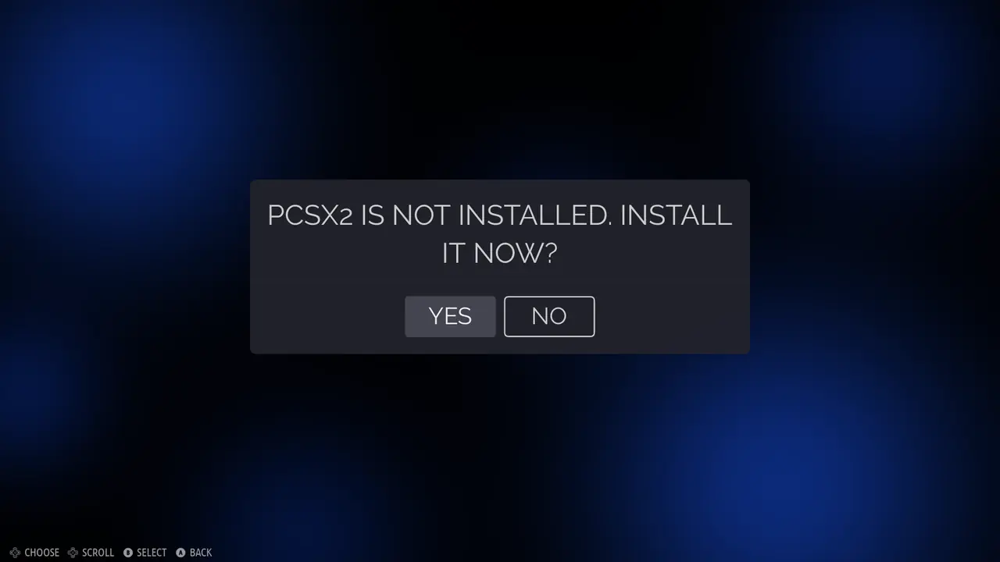 |
| **The overlay** ([retrobox-overlay](https://github.com/RetroboxProject/retrobox-overlay)), opened with a tap on Home/Guide (Hotkey+A where the hotkey is Select) in any game. | **The setup screen**, when a game needs an emulator that isn't installed yet (see [Emulator setup screen](#emulator-setup-screen)). |
| 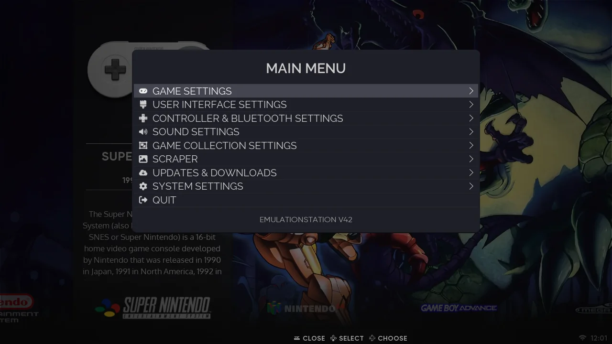 | 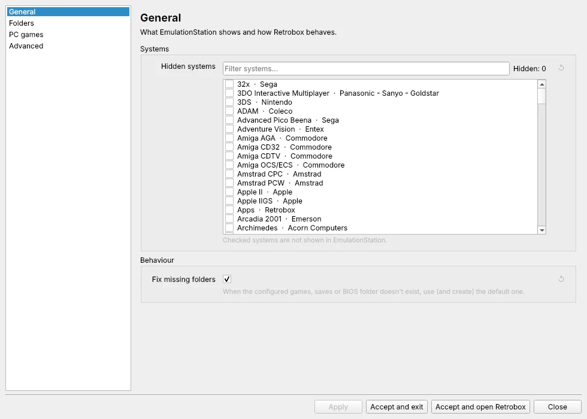 |
| **Main menu** of retrobox-emulationstation, with Bluetooth, network and content downloads. | **Settings window** (`retrobox --settings`) for `retrobox.ini`, and for retrobox-overlay's `overlay.ini` where it is installed. |

## Architecture

```
EmulationStation (separate package)
    └── on game launch → bin/retrobox-launch      (python3 -m retrobox.launcher)
            ├── configgen   (lib/retrobox/configgen: writes emulator configs, builds the command)
            │       └── libexec/stubs/batocera-resolution  (stub → kscreen-doctor / wlr-randr / xrandr)
            └── retrobox-inputd  (retrobox-overlay package: hotkeys and pad2key profiles while the game runs)
```

This repo can be cloned and used from anywhere, or installed into `/opt/retrobox` with the `.deb`, the `.rpm` or `install.sh`. Its paths replace batocera's `/userdata` hierarchy: see [Paths](#paths).

## Key changes vs upstream batocera-configgen

### Paths

Configuration is layered, read-only code and writable user data are separate, and the layout is the same whichever way Retrobox was installed (`.deb`, `install.sh`, a checkout).

**Read-only install** (`/opt/retrobox`, the `install.sh` prefix, or a checkout) is never written to.

**Configuration layers**, lowest priority first. Each mirrors the `share/` tree (`systems/`, `emulator_options/`, `hooks/retrohook.d/`, ...) and a file with the same relative path replaces the one below it; extra files add systems, emulator options or hooks:

1. `<install dir>/share` — shipped defaults
2. `/etc/retrobox` — administrator (optional)
3. `~/.config/retrobox` — user (`$XDG_CONFIG_HOME/retrobox`)

Every Retrobox program (the core, the overlay, the system settings and sessions) reads its configuration from these two places only: only `XDG_CONFIG_HOME` moves the user's. `RETROBOX_CONFIGDIR` is exported to the programs Retrobox starts, but setting it moves nothing.

`retrobox.ini` is merged the same way, key by key: `/etc/retrobox/retrobox.ini`, `/etc/retrobox/retrobox.ini.d/*.ini`, `~/.config/retrobox/retrobox.ini`, `~/.config/retrobox/retrobox.ini.d/*.ini` (drop-ins in alphabetical order). Retrobox never writes these files: defaults live in code and the files only hold changes. The package ships a commented template in `/etc/retrobox/retrobox.ini`.

**User directories:**

| Directory | Default | Override | Holds |
|---|---|---|---|
| config | `~/.config/retrobox` | `XDG_CONFIG_HOME` only | `retrobox.ini(.d)`, overrides of `share/` (same tree), `emulators/<emu>/` (each emulator's `XDG_CONFIG_HOME`), `frontend/` (EmulationStation home), `pad2key/profiles/`, `hooks/` |
| data | `~/.local/share/retrobox` | `RETROBOX_DATADIR` | `roms/`, `saves/`, `bios/`, `themes/`, `music/`, `decorations/` (+ `decorations-default/`), `shaders/`, `emulators/` (installed binaries), `screenshots/`, `recordings/`, `cheats/`, `overlay/` |
| state | `~/.local/state/retrobox` | `RETROBOX_STATEDIR` | `logs/`, installer manifests |

`$XDG_CONFIG_HOME`, `$XDG_DATA_HOME` and `$XDG_STATE_HOME` are honoured. The data and state directories can also be set from `[paths]` in `retrobox.ini` (`data_dir`, `state_dir`; the environment variables win), and `roms`, `saves` and `bios` can be moved on their own (`roms_dir`, `saves_dir`, `bios_dir`); the last layer that sets a key wins. A value may be quoted and may end in ` # comment`. If a configured `roms_dir`/`saves_dir`/`bios_dir` is not a readable directory, Retrobox warns on stderr and uses the default one (unless `autocorrect_paths = false`).

Other `[core]` keys: `create_rom_folders` (`true` by default: see below), `ignore_systems` (systems hidden from the menu, e.g. `gba,psp`) and `steam_sync`, `heroic_sync`, `lutris_sync`: on every start, add the games installed in that launcher to its system (`.steam`, `.heroic`, `.lynx` entries). Each one takes:

| Value | Entries go to (and the ES system reads from) |
|---|---|
| `none` (default) | nothing is synced; the system reads `<roms_dir>/<launcher>` |
| `on-base-dir` | always `<data dir>/roms/<launcher>`, wherever `roms_dir` points |
| `follow-roms-dir` | `<roms_dir>/<launcher>` (which may be `<data dir>/roms` or anywhere else) |

**ROM folders.** On every start, each system gets `<roms_dir>/<system>` if it does not exist yet, with an `_info.txt` as in batocera: the file extensions the system accepts, its emulators and cores (and the extensions some cores do not take) and a few tips, in English (`lib/retrobox/startup/frontend_conf/roms_dirs.py`). An `_info.txt` that already exists is never rewritten (edit or delete it freely; delete it and it comes back on the next start), it holds no paths of this machine, and an existing folder is not touched otherwise. Not created: the systems with a `path` of their own in their YAML (Retrobox's own entries, or one you moved), the PC-games stores (`steam_sync` and friends manage those) and the groups. Nothing is created if the `roms_dir` itself is missing (an unmounted drive, say), and `create_rom_folders = false` turns it all off.

`lib/retrobox/paths` is the single place where all of this is resolved. Shell scripts get the result as `RETROBOX_*` variables (`PYTHONPATH=<install dir>/lib python3 -m retrobox.paths` prints them, `--get section.key` reads a merged ini value; `tools/lib/paths.sh` loads them).

Compared with batocera:

| batocera | here |
|---|---|
| `/userdata` | data dir (see above) |
| `/userdata/system/configs/<emu>` | `~/.config/retrobox/emulators/<emu>` |
| `/userdata/bios`, `/userdata/saves`, `/userdata/roms` | `bios/`, `saves/`, `roms/` in the data dir (or wherever `[paths]` says) |
| `/var/run/*` | `$XDG_RUNTIME_DIR/retrobox` (per user, 0700; `RETROBOX_RUNTIME_DIR`) |
| `/usr/share/batocera` | `<install dir>/share` |
| `/usr/share/batocera/evmapy` | `<install dir>/share/pad2key/profiles` (user profiles: `~/.config/retrobox/pad2key/profiles`) |

Emulators that keep their binary and their config together (redream, supermodel) use `~/.local/share/retrobox/emulators/<emu>`.

### Systems and emulator options

Two folders of `share/` describe what EmulationStation offers; both are layered (see above), so a file of the same name in `/etc/retrobox` or `~/.config/retrobox` replaces the shipped one and a new file adds to it:

- `share/systems/<manufacturer>/<system>.yaml`: one system per file (the key is the system name and must match the file name): full name, ROM extensions, theme and the emulators and cores that can run it, with the default one. `share/systems/defaults.yml` holds the options every system starts from. `retrobox` turns the tree into EmulationStation's `es_systems.cfg` at every start.
- A system's `path` (where EmulationStation finds its games) defaults to `<roms_dir>/<system>`. Set in the YAML, it may use `{data}`, `{roms}`, `{screenshots}`, `{recordings}`, `{share}` and `{root}` for Retrobox's folders (as retrobox.ini and the environment set them) and `~` for the home; a relative path starts at the data folder. EmulationStation gets it absolute. Retrobox's own entries use them: the image viewer shows `{screenshots}`, *Recordings* `{recordings}`, *Library* `{data}/library` and *Apps* `{data}/apps`.
- `share/emulator_options/<emulator>[_<core>].yaml`: the options menu of an emulator or of one of its cores (the `emulator_name` and `core_name` keys), with the shared ones listed in `_global_config.yaml`. An emulator file can also hold a `systems:` block with options for one system only. They become `es_features.cfg`.

Arcade coverage is deliberately small: `mame` (with the older `mame2003` and `mame2010`), `fbneo`, `dice`, Sega `model1`, `model2`, `model3`, `naomi`, `atomiswave` and `systemsp`, and `triforce`. Game-specific engines (fantasy consoles, the Quake, Doom 3 and Cave Story ports...) are not shipped, except `prboom`; drop a system file in your configuration layer to add one.

### Stubs for batocera-only binaries

batocera ships system-specific binaries that don't exist on a standard Linux install. configgen still calls one of them, replaced in `libexec/stubs/`:

- **`batocera-resolution`**: bash wrapper over `kscreen-doctor` (KDE Wayland), `wlr-randr` (wlroots compositors) or `xrandr` (X11)

The Vulkan checks run `vulkaninfo` from Python (`configgen/utils/vulkan.py`).

### BIOS

A system declares the BIOS files it needs in its own YAML, under `bios:` (the format is described in `lib/retrobox/bios.py`, the only code that reads it). Each entry is a requirement met by one file, or by any of its `one_of` alternatives (one per region, say), with the MD5 of the known good dumps (taken from batocera's list and libretro-database's `System.dat`) or a glob when any dump will do; `min_size` leaves out the files too small to be one. Paths are relative to the BIOS folder; one starting with `{roms}/` is relative to the ROMs folder (MAME and Flycast also find their BIOS sets next to the games). `required_for` names the emulators or cores that can't run the system without it (none: all of them), and `optional: true` marks a file that only helps. Like the rest of a system's YAML, a copy in `~/.config/retrobox/systems/` replaces the shipped one.

`retrobox --doctor` checks the BIOS of every system that has ROMs, for the emulator it runs with (its default, or the one chosen in EmulationStation): an error when that emulator needs a file that is missing, a warning when a file is there but is not a known dump and when an optional file is missing (the emulator runs without it, but not as well), a note when only other emulators of the system need it. The MD5s are cached in `~/.cache/retrobox/bios-md5.json`, so only new or changed files are read. Every system in batocera's list (`batocera-systems`) has its BIOS declared; `python3 dev/batocera_bios.py` reports the files or MD5s batocera knows and our YAMLs lack, so the list can be kept in step; every other Monday CI runs it (`.github/workflows/upstream.yml`, apart from the build) and opens a `batocera-bios` issue when batocera's list has something new. PlayStation and PlayStation 2 accept the dumps of every region by name (PlayStation 2's `pcsx2/bios/ps2-*.bin`, checked by MD5 when the dump is known and by size otherwise), not only the American one batocera asks for. MAME sets are only noted, never required, since MAME looks for them in several folders.

EmulationStation's *Missing BIOS check* (in *Game settings*) lists, for every system, the BIOS the emulator it runs with can't do without, the optional ones and the files that are there but are not known dumps, from the same declarations: it runs `bin/retrobox-bios` (`--filter SYSTEM` reads only that system for the pre-launch check), which prints what batocera's `batocera-systems` does, through a patch of retrobox-emulationstation (`0014-missing-bios-check-through-retrobox-bios.patch`). Its *Installed systems* tab only shows the systems that have games. EmulationStation asks before each game when that list has something missing (*Check BIOS files before running a game*, on by default), before starting its launch transition, so a game whose BIOS only helps gets a warning too; if the player agrees, the transition starts once and the launcher (below) then decides whether the game can start.

When a game starts, the launcher checks the same declarations for the emulator and core it runs with, right after the emulator itself (see *Emulator setup screen*): if a BIOS it can't run without is missing, the game doesn't start and EmulationStation shows which file to put where (a `RetroboxException`, exit status 250). An optional BIOS never stops a game, even when EmulationStation asked about it: the game starts anyway. A file that is there but is not a known dump is only logged, since many alternative dumps work.

### Emulator configuration

Each emulator gets its own `XDG_CONFIG_HOME` under `~/.config/retrobox/emulators/<emu>` (RetroArch: `~/.config/retrobox/emulators/retroarch/retroarch/retroarch.cfg`), so nothing in your regular `~/.config` is touched. Controller configs use SDL device names instead of batocera's evdev ones where the emulator supports it (Dolphin, Azahar...).

The Eden and Ryujinx generators were adapted from a third-party batocera package.


### Console mode and the system's settings

Console mode is Retrobox's way of making EmulationStation a console's only screen: Retrobox is started with `--console`, and EmulationStation's *Quit* opens batocera's full quit menu (restart, suspend, shut down) instead of asking whether to quit it, and EmulationStation cannot be quit from its menus, F4 or with Alt+F4 (retrobox-emulationstation's patch 0015); Retrobox writes `ShowOnlyExit` and `ShowExit` in `es_settings.cfg` before it starts. Console mode is on only with `--console`: it is not a setting of retrobox.ini, so nothing turns it off except not passing the argument (Retrobox's session scripts pass it). With it and no system settings program, nothing is offered.

In console mode, EmulationStation's *System settings* also offer the machine's **time zone**, **keyboard layout and variant** and **language**, as batocera's do (retrobox-emulationstation's patches 0019 and 0020). Those are the system's settings, not Retrobox's, so Retrobox doesn't set them: what turns the machine into a console (its session, its user and their permissions) provides a program that does, and Retrobox only tells EmulationStation where it is. That program is `[core] system_settings` in `retrobox.ini`, else `retrobox-system-settings` from the `PATH`; in console mode its path goes into `es_settings.cfg` (`RetroboxSystemSettings`), and with none these settings are not offered (the language is then EmulationStation's own, as on a desktop). EmulationStation runs it as:

```
<program> timezone get | set ZONE
<program> keyboard get | list-layouts | list-variants LAYOUT | set LAYOUT [VARIANT]
<program> locale get | list | set LANGUAGE
```

`get` prints the value (`<layout> <variant>` for the keyboard, `none` when there is no variant; a language is `es_ES`), the lists print `<code> <description>` lines, and a failure exits non-zero with the reason as its last line, which EmulationStation shows. After a new keyboard layout or language EmulationStation offers to restart, so the session starts with it. In console mode the language EmulationStation offers is the system's: only those it has a translation for and the system has a locale for (on Debian, the generated ones); choosing one sets the system's and EmulationStation's.

## New components

### Pad-to-keyboard mappings

A replacement for evmapy: the input daemon of the overlay (`retrobox-inputd`, in the [`retrobox-overlay`](https://github.com/RetroboxProject/retrobox-overlay) package, 0.5.5 or later). For each game the launcher composes its profile (see below) and names it in `session.json` (`pad_profile`); while the game runs, the daemon maps each player's controller with it to keys, shortcuts, commands and mouse events, using evmapy-style JSON profiles (`share/pad2key/profiles/*.keys`, overridable in `~/.config/retrobox/pad2key/profiles`). Without the overlay the game still runs, but with no gamepad hotkeys.

**The daemon.** Retrobox runs it as long as EmulationStation runs. Where systemd is the init and the user manager is reachable, as the user unit `retrobox-inputd.service` (installed by the overlay, never enabled): before starting it, Retrobox writes `$XDG_RUNTIME_DIR/retrobox/inputd.env` (the environment EmulationStation runs with, and `RETROBOX_PARENT_PID`), and stops it when EmulationStation ends; its log is in the journal (`journalctl --user -u retrobox-inputd`). Elsewhere it runs as a child of Retrobox (`retrobox-inputd --parent PID`, log in `<state dir>/logs/inputd.log`). Either way it stops on its own if Retrobox's process ends without stopping it.

**Standard hotkeys.** Every emulator gets the same combinations for player 1, from `share/pad2key/hotkeys.yaml` (copy it to `~/.config/retrobox/pad2key/hotkeys.yaml` to change them):

| Combination | Action |
|---|---|
| Hotkey+Start | Leave the game (`retrobox-emukill`) |
| Hotkey+B | RetroArch's menu, which pauses the game (RetroArch only) |
| Hotkey+X | Screenshot (`retrobox-screenshot`) |
| Hotkey+Y | On-screen keyboard (where the app has one) |
| Hotkey+Left / Hotkey+Right | Rewind / fast forward |
| Hotkey+R1 | Translate (AI service) |
| Hotkey+L2 / Hotkey+R2 | Swap screens / next screen layout |
| Hotkey+L3 | Next disc |
| Hotkey+R3 | Show or hide the bezel |

On the keyboard (any keyboard, right or left modifiers):

| Keys | Action |
|---|---|
| Shift+Esc | Leave the game (`retrobox-emukill`; RetroArch does it itself) |

The daemon does not take these keys from the game, so they use keys emulators leave free (RetroArch's own Shift hotkeys use F1-F6 and F9-F12). Only commands are bound to the keyboard.

**The overlay** (`retrobox-overlay`, when installed) is not in the table: the same input daemon opens the overlay anywhere in Retrobox, in a game or in EmulationStation, with a tap on a dedicated hotkey (Home/Guide: an input of its own in `es_input.cfg`), and nothing else on those controllers; where the hotkey is a button the game uses (Select, on controllers without Home/Guide), which never taps, with Hotkey+A. Ctrl+Shift+O (Shift+F7 too, for keyboards whose function keys need Fn) opens it from a keyboard. Saving and loading states, and choosing their slot, are done from the overlay: there are no hotkeys for them. The `overlay` setting (global, per system or per game) keeps it from opening over a game. The table's `keyboard` section holds the keyboard chords; a user table can replace the `pad` and `keyboard` sections separately. A line with `emulators` (a list of emulator names, `libretro` for RetroArch) is only for those emulators.

Each generator says how its emulator performs these actions (`hotkey_bindings()`, see `lib/retrobox/configgen/hotkeys.py`): a key chord the daemon presses, a command, or `Native` when the emulator reads the combination itself (RetroArch does, from its own configuration). An action the emulator cannot perform leaves its combination free. Leaving the game, screenshots and the overlay work in every emulator. For each game the launcher writes `<runtime dir>/pad2key/session.keys`: the game's own profile (the first of `<rom>.keys`, then `<system>.<emulator>.<core>.keys`, `<system>.<emulator>.keys`, `<system>.keys`, `<emulator>.keys` and `any.keys` in the user's profiles and then in `share/pad2key/profiles`) plus these hotkeys; a combination the game's profile already maps keeps the profile's meaning.

**Leaving a game.** `retrobox-emukill` ends the game being played (Retrobox's `batocera-es-swissknife --emukill`): it first asks the game's windows to close, as the window's X button does (`wmctrl -c` on X11, `wlrctl window close` on Wayland, where it is the focused one), and gives the game 3 seconds to quit by itself and save; then SIGTERM to the emulator's process group and to the processes of a Steam, Heroic or Lutris game, which a running client starts outside it, then SIGKILL to whatever is left after a few seconds. The launcher publishes the running game in `<runtime dir>/session.json` for it (and for the overlay). From the moment it starts until it exits it also keeps `<runtime dir>/launch.json`, which tells whether the game is starting, running or ending: the overlay neither opens nor stays open while a game starts or ends.

### Keeping the computer awake

Most desktops don't count controller input as activity, so a game played with a gamepad only would see the screen dim, turn off or lock, or the computer go to sleep. While a game runs (from its `on-start-game` hooks to the moment it ends) the launcher holds two inhibitors, and releases them when the game is over; in EmulationStation nothing is held, so the desktop's own power settings apply there (`lib/retrobox/launcher/idle_inhibit.py`):

- **logind:** a `block` inhibitor of `idle` and `sleep`, through `systemd-inhibit` (or `elogind-inhibit`). It stops automatic suspend, and desktops that follow logind's idle inhibitors (KDE Plasma among them) keep the screen on too. Closing a laptop's lid still suspends it.
- **`org.freedesktop.ScreenSaver`** on the session bus, which most desktops use to keep the screen on and unlocked. It needs the `jeepney` Python module (`python3-jeepney`, recommended by the packages).

`systemd-inhibit --list` shows the first one (who *Retrobox*, why *Playing <game>*). Both are released even if the launcher is killed, and if one can't be taken the game starts anyway and the log says why.

### Bezels and aspect ratios

A bezel is looked up in this order, in your `decorations/<set>` first and then in `decorations-default/<set>`: the game (`games/<system>/<rom>.png`, then `games/<rom>.png`), the system (`systems/<system>.png`, with its alternative decoration and language variants) and `default.png`. Before any of those, the same order is tried with the screen's aspect ratio appended to the name: on a 16:10 screen, `systems/megadrive_16_10.png` beats `games/megadrive/Sonic.png`, and `games/fbneo/truxton2_16_10.png` beats both. The suffix is `_<width>_<height>` of a common ratio (`1_1`, `5_4`, `4_3`, `3_2`, `16_10`, `16_9`, `21_9`, `32_9`; a 2560x1080 screen still counts as `21_9`) or of the screen's exact one, and the bezel's `.info`, `.lay` and `.zip` carry it too (`megadrive_16_10.info`). A bezel made for another ratio is stretched or narrowed to the screen, unless *Stretch bezels* is turned off for the game.

### Netplay

EmulationStation's lobby and *Netplay settings* menu work as in batocera and RetroArch's cores do the rest: the launcher turns `-netplaymode host|client|spectator` (plus `-netplayip`, `-netplayport`, `-netplaysession` and `-netplaypass`) into RetroArch's `--host`, `--connect`, `--port`, `--mitm-session` and `--nick`, and writes the matching `netplay_*` options of `retroarch.cfg` on every launch: nickname, port, the relay server (`nyc`, `madrid`, `montreal`, `saopaulo`, a community one or a custom address), public announce for hosts, spectator mode and the room password. Hardcore RetroAchievements mode is turned off while a room is open, because it disables the savestates netplay is built on. EmulationStation only offers netplay for the cores listed in `core_features: netplay:` of `share/emulator_options/libretro.yaml` (it gives them the `netplay` feature, which is what EmulationStation checks) (the same set as batocera), and it has to be turned on in its menu (`global.netplay`). The code is in `lib/retrobox/configgen/generators/libretro/libretro_netplay.py`.

### RetroAchievements

EmulationStation's *RetroAchievements settings* menu (account, hardcore mode, leaderboards, rich presence, encore mode, screenshots, challenge indicators, unofficial achievements, unlock sound) drives the emulators that earn achievements: RetroArch, PCSX2, Dolphin and Flycast. On every launch their settings are written from it (`retroarch.cfg`'s `cheevos_*`, PCSX2.ini's `[Achievements]`, Dolphin's `RetroAchievements.ini`; Flycast only takes the account and hardcore mode), all of them, so what one game turned on never leaks into the next. They are managed from EmulationStation, not from the emulators' own menus: a login or option set there is overwritten on the next launch (an `retroarch.cheevos_*` line in the game's settings still wins). The login token that EmulationStation gets when the account is validated is used. Without a token, RetroArch logs in with the password itself; for the others, which can't, Retrobox asks the server for a token with it, and leaves achievements off for that game if it can't get one. The account and the switches are read in one place (`lib/retrobox/configgen/utils/achievements.py`).

The overlay's *Achievements* page lists the game's achievements, earned or not, with the same account, which the launcher passes in `session.json`.

- **Hardcore mode** turns off rewind and the automatic loading of a state, and is off while a netplay room is open (it disables the savestates netplay is built on). Leaderboards only count together with hardcore, as the menu says.
- **Unlock sound:** the `.ogg` files of `<data dir>/retroachievements-sounds/` (and of `/usr/share/libretro/assets/sounds/`) are the ones the menu offers. PCSX2 and Dolphin play their own sounds, turned on when one is picked.
- **Which cores and emulators:** PCSX2, Dolphin and Flycast offer achievements for all their games (their `cheevos` feature). For RetroArch, it decides what a core can do, but EmulationStation only offers achievements (the entries, the game hashing, the warning "current core is not compatible") for the cores marked with the `cheevos` feature. The list is `core_features: cheevos:` of `share/emulator_options/libretro.yaml`, taken from the RetroAchievements project's supported cores. `mame*`, `blastem`, `nestopia` and `quasi88` are left out on purpose. To offer it for another core, add it to that list (or to a file of the same name in `~/.config/retrobox/emulator_options/`).
- **RetroArch built from source** (`tools/emulators/retroarch.sh`) is configured with `--enable-cheevos --enable-ssl`, so it fails to build instead of silently lacking achievements or the TLS they log in with.

### Content downloader

`retrobox-store` is the backend of EmulationStation's *Content Downloader* (music, bezels, shaders, free ROMs and homebrew). It reads batocera's store (`https://store.batocera.org/`, a pacman repository) without needing pacman: it downloads the sync database and the packages, checks each package's SHA-256, and unpacks them straight into Retrobox's directories (`userdata/music` into `music/`, `userdata/roms` into the ROMs directory, and likewise `decorations`, `shaders`, `themes`, `bios`, `saves`, `cheats` and `screenshots`; batocera's `userdata/system/configs` goes to `emulators/` in the configuration directory, `~/.config/retrobox/emulators/<emu>` by default; the ROMs, saves and BIOS directories follow `[paths]` in `retrobox.ini`, wherever they are). Packages for another architecture than `any` (batocera's own binaries) are not listed. What it installed is recorded in `<state dir>/store/installed/<package>.json`, so a package can be removed or updated cleanly; the downloaded file is deleted after installing. The archive is untrusted: entries that would land outside those directories, links and special files are skipped, and a package's `exec` instructions (shell code run by batocera's pacman hooks) are never run; its `gamelist` instructions are, to add the games to EmulationStation.

```
retrobox-store list                    # XML for EmulationStation (a table on a terminal)
retrobox-store install <package>       # progress lines "text >>>percent"
retrobox-store remove <package>
retrobox-store refresh | update | clean | clean-all
retrobox-store --repository URL ...    # another repository (or $RETROBOX_STORE_REPO; file:// works too)
retrobox-store install snes9x_libretro # a RetroArch core (see below)
```

**RetroArch's cores** are a second repository, the *libretro* tab of the Content Downloader: every core the [libretro buildbot](https://buildbot.libretro.com/) builds for this machine (x86_64, aarch64, armhf; `nightly/linux/<arch>/latest`), named after the core's file (`snes9x_libretro`), described and grouped by maker from its `.info`, each one installed, updated or removed on its own. They live in `<emulators>/retroarch/cores` and their `.info` files in `<emulators>/retroarch/info`, next to RetroArch's `app/` and not in it, so installing RetroArch again keeps them (the cores of an older install, inside `app/`, are moved there by Retrobox's startup, the store, the launcher and the installer, so every installed core is listed and found, whoever installed it). Their build is kept in `cores/.retrobox-cores.json`: *Update installed content* (`retrobox-store update`) downloads the cores the buildbot has rebuilt, and leaves alone the ones it didn't install (from RetroArch's installer, built from source, or downloaded from RetroArch's own menu), which are listed as installed with an `unknown` version: installing one from the Content Downloader puts it under its management. On ARM, `flycast` is not offered: RetroArch's installer builds it against desktop OpenGL there, until the buildbot's aarch64 build is known to run on it (its `mupen64plus_next` links `libGL`, so that one is downloaded). The first install of RetroArch only downloads a base set (`BASE_CORES` in `lib/retrobox/cores/buildbot.py`: MAME 2003-Plus, FBNeo, FCEUmm, Snes9x, Mupen64Plus-Next, Gambatte, mGBA, Genesis Plus GX, PicoDrive, Flycast, the PC Engine, Neo Geo Pocket, WonderSwan, Pokémon Mini, Game & Watch, Atari 2600/5200/7800/800 and Lynx cores, and PCSX ReARMed). A game whose core is not installed doesn't start, and says which core to download. `RETROBOX_BUILDBOT` points to another buildbot (a mirror, or a `file://` folder laid out the same way).

When a repository can't be reached (the server is down, or blocked), `list` still lists the other one and the cores already installed, and adds an `<error repository="...">` saying why, which EmulationStation shows in a message (patch `0016-content-downloader-shows-repository-errors.patch`); a failed install or removal ends with an `Error: ...` line, which EmulationStation shows too. When the list of cores could not be refreshed, the one downloaded before is used and the message says it may be old.

EmulationStation runs it through a patch of [retrobox-emulationstation](https://github.com/RetroboxProject/retrobox-emulationstation) (`0007-content-downloader-and-sevenzip-without-usr-bin.patch`), which looks for `$RETROBOX_ROOTDIR/bin/retrobox-store` (exported by `retrobox`) instead of `/usr/bin/batocera-store`. Reading `.zst` packages needs Python 3.14, the `zstandard` module or the `zstd` tool.

### Emulator setup screen

When a game needs an emulator that has an installer in `tools/emulators/` but isn't installed, a full-screen dialog offers to install it, shows the installer's output (and takes keyboard input, e.g. a sudo password) and launches the game afterwards. The dialog is the *task screen* of [retrobox-overlay](https://github.com/RetroboxProject/retrobox-overlay) (`retrobox-overlay --task`), drawn with EmulationStation's menu style (its fonts, colours and language; EmulationStation's defaults when there is no theme yet), with buttons usable from a controller, the keyboard, the mouse or a touch screen. Its background is `share/emusetup/background.png`, replaceable from `/etc/retrobox` or `~/.config/retrobox` like any shared file: the overlay finds it itself, for every task screen (the system update's too). The same screen shows the downloads done before EmulationStation starts (default theme, bezels and shaders). Its confirm and back buttons are EmulationStation's, as the overlay reads them from `es_input.cfg`.

**Without the overlay** nothing is offered, installed or downloaded when a game or Retrobox starts: whoever prefers to live without it installs and updates the emulators and the default content by hand, with `retrobox --install-emulator NAME` and `retrobox --download theme|bezels|shaders` (both run in the terminal, with no screen of their own).

**Updating an emulator:** hold **L1 and R1** (or **Ctrl and Shift** on a keyboard) while a game starts, until the task screen appears, and it offers to install that game's emulator again, to get its latest version. The installer then works in a separate folder (`<data dir>/emulators/.update-<name>/`) and the installed emulator is only replaced once the new one is complete: its configuration and data are carried over (the `config` folder, files the new version doesn't ship, and a few known files such as Redream's `redream.cfg` or Supermodel's `NVRAM`), and if anything fails, or the screen is closed halfway, the installed version is left untouched. Either way the game starts afterwards. The overlay reads the controllers' and keyboards' state from the kernel (`retrobox-overlay --held`; keyboards need the `input` group, the packages and `install.sh` add you to it), with the button numbers of `es_input.cfg`; `RETROBOX_REINSTALL_EMULATOR=1` in the environment has the same effect.

### Installing emulators

Each installer in `tools/emulators/` (they share `tools/lib/installer.sh`) takes the same options. `-i`, which `retrobox --install-emulator` and the setup screen use, installs the best way the machine allows: a **Flatpak** for the one program whose Flatpak Retrobox can use (Kodi), else the release **AppImage, extracted** when there is one for its architecture, else the **release archive** (tarball or zip), else a **build from source**. `-f`, `-a`, `-t` and `-s` pick one of them, `-u` uninstalls (what `retrobox --remove-emulator` runs) and `-l` lists what the installer has. `retrobox --install-emulator` with no name lists them all:

| Emulator | AppImage | Archive | Source |
| --- | --- | --- | --- |
| ares | | | ✓ (with librashader) |
| Cemu, Eden, PCSX2, PPSSPP, RPCS3, Ryujinx | ✓ | | |
| Dolphin | ✓ | | ✓ |
| Flycast | ✓ (x86_64) | | ✓ |
| RetroArch | ✓ (x86_64) | ✓ (aarch64: the buildbot's binary, plus the assets) | ✓ |
| Keisho | | ✓ | ✓ |
| Kodi | | | ✓ (aarch64; x86_64 takes the Flathub Flatpak when `flatpak` is installed) |
| Redream, Supermodel | | ✓ | |
| Vita3K | ✓ | ✓ | ✓ |

Everything goes into `<data dir>/emulators/<emulator>/app/`, swapped in only once the new version is complete, so a failed install keeps the previous one. Redream and Supermodel keep their data next to the executable, so their files go at the top of their folder instead, listed in `.retrobox-files` so that an uninstall removes exactly those. An uninstall never touches the configuration (`~/.config/retrobox/emulators/<emulator>`) or the saves. Source builds need `sudo` for their build dependencies (apt or dnf) and honour `JOBS`; `KEEP_SRC=1` keeps the source tree.

**Finding an emulator.** A generator doesn't need Retrobox's own install: it looks for its emulator (`lib/retrobox/configgen/utils/emulator_binary.py`) in this order and runs the first one it finds:

1. Retrobox's install: `app/bin/<name>` or `app/<name>` (a build or an archive), `app/AppRun` (an extracted AppImage), `app/usr/bin/<name>`;
2. the top of the emulator's folder (portable emulators and older layouts), including an `*.AppImage` dropped there;
3. an AppImage of yours in `~/Applications`, `~/AppImages` or `~/.local/bin` whose name starts with the emulator's (`Cemu-2.6-x86_64.AppImage`), the newest if there are several;
4. the distribution's package (`PATH`).

A game only offers to install its emulator when none of them has it, and `retrobox --doctor` says which one each emulator uses. RetroArch, Redream, Supermodel and Keisho are only taken from Retrobox's install, since Retrobox relies on files of that install (RetroArch's cores, the others' data folders). Flatpaks are not looked for: a Flatpak keeps its configuration under `~/.var/app` and only sees the folders it was granted, so the configuration and the paths Retrobox writes for each game would not reach it. MAME, ScummVM, DOSBox, melonDS, Azahar and shadPS4 have no installer and are found the same way (MAME's data, such as `hash/` and `plugins/`, next to its executable or in `/usr/share/games/mame` or `/usr/share/mame`).

### Sega arcade (Keisho)

[Keisho](https://github.com/Keisho-Emu/Keisho) is a native emulator of the Sega Model 1, 2 and 3 boards. Install it with `retrobox --install-emulator keisho` (the upstream release for x86_64 and aarch64, or a build from source with `tools/emulators/keisho.sh -s`). It is the default emulator of `model1` and `model2`; `model3` keeps Supermodel as its default and lists Keisho next to it, and MAME is listed on all three.

- **ROMs:** `roms/model1`, `roms/model2` and `roms/model3`. Keisho identifies a game by the CRC32 of its chips, not by the archive name, so a merged archive can hold several revisions and the archive name picks one (`vf2o.zip`). The *Keisho* entry of the emulator menu opens its own game picker, which lists the three folders.
- **Saves and configuration:** NVRAM, save states and screenshots go to `saves/<system>/keisho` (and `screenshots/keisho`), the configuration to `~/.config/retrobox/emulators/keisho/keisho.ini`. On every launch Retrobox rewrites only the keys it manages (renderer, scaling, audio, pads, wheels, ROM folders), so what you set in Keisho's overlay (F10) stays, such as a pad layout saved for a game.
- **Options:** renderer (OpenGL, Vulkan or software), render scale up to 8x, aspect ratio, scaling, texture filtering, 2D upscale, CRT filter, rewind, rumble and wheel force feedback. Translucency and the extended draw distance only apply to Model 1 and 2; on `model3` there are two more: *Speakers* (stereo or surround, for the four-speaker cabinets) and *Threaded frame building*.
- **Pad layout:** per game for the Model 2 games (taken from RetroBat); Model 1 and 3 games use the default layout, or one of the arcade panel layouts, from *Button layout*.

### PlayStation controllers

In the *Controls* menu of Ares and of the RetroArch PlayStation cores (`pcsx_rearmed`, `mednafen_psx`, `swanstation`), each of the two ports plugs its own controller type: standard, DualShock, and what the core offers besides (dual analog, analog joystick, neGcon). With the standard pad, which has no sticks, the left stick of your gamepad drives the D-pad and the D-pad keeps working; the other types read the sticks themselves. RetroArch does it with its analog to D-pad mode and Ares with a second binding on the D-pad. The device ids differ from one core to another, so each core has its own list in `share/emulator_options/libretro_<core>.yaml`; the choice is read as `controller<port>_<core>` (`ares_psx_port<port>` in Ares). Ares only has the standard pad and the DualShock (no mouse), and plugs the DualShock by default; the cores plug the standard one. The RetroArch cores also offer the PlayStation mouse, for a real mouse plugged into the computer (the first mouse goes to the first port set to *Mouse*); it is not mapped from the gamepad. Multitap and light guns are not offered.

### Apps

An `apps` system with app-like shortcuts to web streaming services (opened in Chrome or Firefox kiosk mode, so one of them must be installed) and Kodi (which needs Kodi).

**Kodi** is started through `bin/retrobox-kodi`, which only launches it: the Flatpak (`tv.kodi.Kodi`) if installed, else a native `kodi`, Retrobox's build (`<emulators>/kodi/app/bin/kodi`) first (`RETROBOX_KODI=flatpak|native` forces one; `--which` prints the one it would start).

It is installed like an emulator (`tools/emulators/kodi.sh`, `retrobox --install-emulator kodi`), and the same screen offers it when Kodi is started and missing, or again with L1 and R1 held to update it. On x86_64 with `flatpak` installed it is the Flathub Flatpak, for the user (Flathub is added for the user if needed; `<emulators>/kodi/app/.retrobox-flatpak` marks it, and `-u` removes the Flatpak); otherwise, and always on aarch64, it is built from source: Kodi's latest stable release (`KODI_REF` picks another tag), X11 (`KODI_PLATFORM`), OpenGL on x86_64 and OpenGL ES on ARM (`KODI_RENDER`), with its `peripheral.joystick` add-on; Kodi 21 needs PCRE1, which Debian 13 and recent Fedora no longer ship, so when `pkg-config` finds no `libpcre` the build makes its own static copy (`ENABLE_INTERNAL_PCRE`). Either way it comes with the [WebApp Launcher](https://github.com/manu-romero-411/plugin.program.webapplauncher) add-on (`plugin.program.webapplauncher`), copied into that Kodi's add-ons folder (`~/.var/app/tv.kodi.Kodi/data/addons` or `~/.kodi/addons`) and enabled by configgen in Kodi's add-on database every time Kodi starts from Retrobox (Kodi keeps add-ons copied by hand disabled; on its very first start, before it has a database, the add-on is enabled from the next one on). EmulationStation's Kodi entry shows when Kodi is installed or can be (`retrobox-kodi --check`), so that it can offer the install. Before that, configgen writes the controllers' button maps for Kodi's `peripheral.joystick` add-on into the userdata folder of that Kodi (`~/.var/app/tv.kodi.Kodi/data/userdata` or `~/.kodi/userdata`), mirroring EmulationStation's layout (the buttons by position, L3/R3 included; with *Switch confirm & cancel buttons* the east button confirms, as in EmulationStation). The hotkey is not mapped, because it is a modifier in Retrobox. A native Kodi needs the `peripheral.joystick` add-on, which some distributions package separately. If no Kodi is installed and the install is declined or can't be shown (no overlay), configgen stops before anything starts with a `RetroboxException` ("Kodi is not installed: install it with 'retrobox --install-emulator kodi'..."), also when no controller is connected. EmulationStation's *Kodi media center* menu entry shows when `retrobox-kodi --check` succeeds and goes through the same path (`retrobox-launch -system apps -emulator kodi -rom config`). Kodi uses its own gamepad handling, so its `apps.kodi.keys` pad profile is empty (it only gets the standard hotkeys, such as Hotkey+Start to leave).

The input daemon maps the player 1 gamepad so the web pages can be used without a mouse (`share/pad2key/profiles/apps.keys`; buttons in SNES layout):

| Input | Action |
|---|---|
| Left stick / right stick | Move the mouse cursor / scroll |
| D-pad | Arrow keys |
| B | Left click |
| A | Back (`Alt+Left`) |
| Start / Select | Play/Pause / `Tab` |
| L1 / R1 | Page Up / Page Down |
| Hotkey+L1 / Hotkey+R1 | Previous / next media |
| Hotkey+Y | `Meta+O` (on-screen keyboard shortcut) |
| Hotkey+X | `Meta+SysRq` (screenshot) |
| Hotkey+Start | Exit back to EmulationStation |

## Setup

### From a release (recommended)

**Debian / Ubuntu (.deb):**

```bash
sudo apt install ./retrobox-core_<version>_all.deb   # use apt, not dpkg -i: it pulls the dependencies
                                                      # installs into /opt/retrobox, /usr/bin/retrobox
```

**Fedora (.rpm):**

```bash
sudo dnf install ./retrobox-core-<version>-1.noarch.rpm   # same layout as the .deb; vlc-libs (RPM Fusion) is only recommended
```

**Any supported distro (install.sh):**

```bash
curl -fsSL https://github.com/RetroboxProject/retrobox-core/releases/latest/download/install.sh | bash
# options: --prefix DIR  --user  --version X.Y.Z  --continuous  --with COMPONENT  --no-deps  --uninstall  (see --help)
```

Every push to `main` publishes a rolling **continuous** pre-release (`X.Y.Z.<UTC timestamp>`, above the last release, below the next), so each build installs over the previous one: `install.sh --continuous`, or `sudo retrobox-update --allow-prereleases` once installed. Real releases are published by hand: run the *build* workflow with a tag.

It installs the same layout as the package: `/opt/retrobox` (or `/var/opt/retrobox` if `/opt` isn't writable, or `--prefix`), a `retrobox` launcher in `/usr/local/bin`, the application menu entry and its icon in `/usr/local/share` (the packages use `/usr/share`; `--user`, `~/.local/share`), udev rules and the optional `/etc/retrobox`. Dependencies come from apt/dnf (`tools/deps/*.list`, shipped in the tarball's `extras/`, not in the installed tree); on immutable systems (ostree) or with `--no-deps` the Python ones go into a virtualenv inside the install and the script prints the system libraries to layer (e.g. with `rpm-ostree install`). Without root, `--user` installs under `~/.local`.

### Components

The core is modular. EmulationStation ([`retrobox-emulationstation`](https://github.com/RetroboxProject/retrobox-emulationstation)) and the patched MangoHud ([`retrobox-mangohud`](https://github.com/RetroboxProject/retrobox-mangohud)) are separate projects; so is the overlay ([`retrobox-overlay`](https://github.com/RetroboxProject/retrobox-overlay)), with its input daemon and pad-to-keyboard mapper. `retrobox-core` ships no frontend, no MangoHud, no theme and compiles nothing. If EmulationStation finds no theme at all (neither in `<install dir>/frontend/themes` nor in `<data dir>/themes`), `retrobox` downloads the latest commit of [*es-theme-iconic*](https://github.com/manu-creative-411/es-theme-iconic) into `<data dir>/themes` before starting; `retrobox --download theme` downloads it again (update, or reinstall if it was removed). The [RetroBat bezels](https://github.com/RetroBat-Official/retrobat-bezels) (the default decorations) are downloaded the same way into `<data dir>/decorations-default`, and [Retrobox's shaders](https://github.com/RetroboxProject/retrobox-shaders) into the shaders folder (`<data dir>/shaders`, or `SHADERS_DIR`), but only on the first start (the bezels, only if their folder holds no files yet); `retrobox --download bezels` / `shaders` get them again. The bezels replace their folder, which belongs to Retrobox; the shaders are merged into theirs, so your own shaders there are kept. All these downloads show their progress on the setup screen (see *Emulator setup screen*), can be cancelled with B / Esc, never replace a working copy with a broken one, and if they fail Retrobox says so and starts anyway.

- **Packages (.deb/.rpm):** `retrobox-core` only *recommends* `retrobox-emulationstation`, `retrobox-mangohud` and `retrobox-overlay` (0.5.5 or later); install them with the package manager. Those packages are built per architecture (amd64, arm64); the core is architecture-independent (`_all.deb`, `noarch.rpm`).
- **install.sh:** `--with emulationstation` / `--with mangohud` downloads the component's own `install.sh` (the one at the root of its repository, or `--with NAME=<URL or local path>`) and runs it:

  ```
  install.sh --prefix DIR --bin-dir DIR [--no-deps] [--user]
  install.sh --uninstall --prefix DIR --bin-dir DIR
  ```

  with `RETROBOX_PREFIX`, `RETROBOX_BIN_DIR`, `RETROBOX_ARCH` (`amd64`, `arm64` or the raw `uname -m`) and `RETROBOX_CORE_VERSION` in the environment. The contract for a component installer: pick the build for `RETROBOX_ARCH` (and say so clearly if there is none), write only below `--prefix` (plus its commands into `--bin-dir`), and remove everything it installed on `--uninstall`. The same files go in the packages as in the install: ES in `<prefix>/frontend/`, MangoHud in `<prefix>/libexec/mangohud/` (`bin/mangohud` and `share/vulkan/implicit_layer.d/`), with no installers, docs or helper scripts left in the tree. `install.sh` keeps a copy of each component installer in `<prefix>/.components/<name>/` to update it with the core and to remove it on `--uninstall`.

`retrobox` warns at startup if EmulationStation is missing; without the patched MangoHud it falls back to a system-wide `mangohud`.

### Running from the repo (development)

Retrobox keeps the *operational* part (this tree: code, `share/`, `libexec/`, installed at `/opt/retrobox` by the packages and `install.sh`) apart from the *mutable* part (ROMs, BIOS, saves, themes, music, emulators... under `~/.local/share/retrobox`, `~/.local/state/retrobox` and `~/.config/retrobox`, see *Paths*). The tree is never written to at runtime, and a checkout holds no such content either, so it is not an install method: install with a package or `install.sh`.

For debugging, `bin/retrobox` also runs straight from a clone, using the same user directories as an installed Retrobox. You need the dependencies of `tools/deps/*.list` (and `pip install -r requirements.txt` for a virtualenv), the udev rules of `system/udev/` and, as components, EmulationStation, MangoHud and the overlay (their packages, or `install.sh --with ...`, which installs them next to the core).

### Building the packages

```bash
packaging/deb/build-deb.sh           # dist/retrobox-core_<version>_all.deb
packaging/rpm/build-rpm.sh           # dist/retrobox-core-<version>-1.noarch.rpm (needs rpmbuild)
packaging/tarball/build-tarball.sh   # dist/retrobox-core-all.tar.gz + SHA256SUMS (the install.sh payload)
```

The GitHub Actions workflow runs the checks below, builds the three and smoke-tests them in Ubuntu 24.04, Debian 13 and Fedora containers. It only runs by hand (`workflow_dispatch`, which `release-dispatch` triggers): with a `version` (e.g. `v0.3`) it publishes the packages, `install.sh` and `SHA256SUMS` as a GitHub Release (tick `prerelease` for a pre-release); without one it only builds and tests. Pushes and pull requests build nothing, so run `dev/check.sh` before pushing. Only `vX.Y` and `vX.Y.0` are full releases; any other `vX.Y.Z` is a pre-release.

### Tests and checks

```bash
pip install -r dev/requirements-dev.txt   # pytest and pylint, pinned
dev/check.sh                              # everything CI checks
dev/check.sh tests | pylint | shell       # one part
```

- **tests:** `tests/` (pytest) covers the parts that run without hardware: the configuration layers and `[paths]` of `retrobox.ini`, the bezel lookup order, the systems and emulator options and the `es_systems.cfg` / `es_features.cfg` built from them (every emulator a system offers must have a working generator), the ROM folders, the store's unpacking of untrusted packages, RetroArch's cores (from a fake buildbot), the idle inhibitor, the desktop notifications, RetroAchievements (the shared account, PCSX2, Dolphin and RetroArch), the BIOS declarations and their check, the doctor, the `retrobox` command line, the installers' shared library and where emulators are found. They never touch your home: every run gets its own home, XDG and `/etc/retrobox` in a temporary directory. CI runs them on Ubuntu 24.04, Debian 13 and Fedora with the distribution's own Python packages.
- **pylint:** strict for all the Python code except `lib/retrobox/configgen`, which comes from batocera and is held to `dev/pylint-baseline.json` instead (all messages but `duplicate-code`): a file may not get a message it didn't have, so it only gets cleaner. After cleaning some of it, lower the baseline with `python3 dev/pylint_baseline.py --update`.
- **shell:** `bash -n` and `shellcheck --severity=warning` on every shell script.

A release can only be published once all of them pass.

### Command line

```
retrobox [-- ARGS...]                 start Retrobox; ARGS go to EmulationStation
retrobox --install-emulator [NAME...] install or update emulators (no name: list the installers)
retrobox --remove-emulator NAME...    uninstall emulators (configuration and saves are kept)
retrobox --install-bezels [NAME...]   install or update bezel packs (no name: list them)
retrobox --remove-bezels NAME...      remove bezel packs
retrobox --download [WHAT...]         download the default theme, bezels or shaders again (no name: list)
retrobox --settings                   open the settings window (edits ~/.config/retrobox/retrobox.ini)
retrobox --doctor [--json]            check what Retrobox needs on this computer, and how to fix it
retrobox --version | --help
```

One action per call: anything else on the command line is an error, and so is an unknown option (arguments for EmulationStation go after `--`). Each start also warns, without stopping, when something essential is missing (Python modules, EmulationStation, the overlay's input daemon).

`retrobox --doctor` checks, without changing anything, what Retrobox needs on this computer: the Python modules, EmulationStation, the overlay and MangoHud, a theme, the graphical session and the tool that changes screen modes on it, Vulkan, controllers, the `input` group, `/dev/uinput` and the udev rules, what keeps the computer awake during games, the ROMs and BIOS folders and free space, the installed emulators, the BIOS of the systems you have ROMs for and the RetroAchievements account. Each line says `[ OK ]`, `[INFO]`, `[WARN]` (works worse, or not in every game) or `[ERR ]` (games won't start), with how to fix it; it exits with 1 when there is an error. `--json` prints the same for a bug report; the RetroAchievements token and password are never printed, only whether they are set.

The settings window (PySide6 or PyQt6) covers the folders, the hidden systems, the PC games sync and the advanced keys of `retrobox.ini`, and saves them in the user layer. It is also the *Settings* action of the application menu entry.

## Directory layout

Install directory (read-only):

```
<install dir>/                 # a checkout, or /opt/retrobox: the repo IS the installed tree
├── bin/                       # commands: retrobox (/usr/bin/retrobox in the packages), retrobox-launch, retrobox-emukill, retrobox-screenshot...
├── lib/
│   └── retrobox/              # the Python package: paths, startup, launcher, configgen, utils
├── libexec/                   # internal helpers: stubs/, mangohud/ (from the retrobox-mangohud component)
├── share/                     # read-only defaults (the lowest config layer): systems/, emulator_options/, configgen/, hooks/, pad2key/...
├── tools/                     # installers (emulators/, decorations/, lib/installer.sh), deps/*.list, setup.sh
├── frontend/                  # EmulationStation seed config (the retrobox-emulationstation component installs here)
├── VERSION                    # (packages only)
└── venv/                      # (install.sh on immutable systems only)
```

Only in the repository (not installed): `dev/` (helper scripts, `check.sh` and notes for developers), `docs/` (the README's screenshots), `tests/`, `packaging/`, `system/` (installed into `/usr/lib/udev` and polkit instead), `install.sh`, `.github/`, `.vscode/`. Python modules are run with `PYTHONPATH=<install dir>/lib`: `python3 -m retrobox.startup` (what `bin/retrobox` runs) and `python3 -m retrobox.launcher` (`bin/retrobox-launch`).

System and user directories (see [Paths](#paths)):

```
/etc/retrobox/                 # optional admin layer: retrobox.ini, retrobox.ini.d/, <share tree overrides>
~/.config/retrobox/            # retrobox.ini(.d), overrides, hooks/, pad2key/, frontend/ (ES home)
└── emulators/<emu>/           # each emulator's XDG_CONFIG_HOME
~/.local/share/retrobox/
├── roms/  saves/  bios/       # moveable from retrobox.ini
├── themes/  music/            # your themes and menu music
├── decorations/               # your bezels (and --install-bezels packs)
├── decorations-default/       # RetroBat bezels (first start; retrobox --download bezels)
├── emulators/                 # installed by retrobox --install-emulator (<emulator>/app/)
├── shaders/                   # Retrobox shaders (first start; retrobox --download shaders) and yours
└── screenshots/  recordings/  cheats/  overlay/
~/.local/state/retrobox/       # logs/, packages/ (installer manifests)
```

Components install into the same directory, so installing them into `/opt/retrobox` needs `sudo`.

### Logs

Every Retrobox tool, bash or Python, prints the same kind of line: `[INFO]`, `[ OK ]`, `[WARN]` or `[ERR ]`, then a `yyyy-mm-dd_hh:mm:ss` timestamp and the message (colored on a terminal; `NO_COLOR=1` turns colors off). The terminal shows `INFO` and above; `RETROBOX_DEBUG=1` adds the `[DBG ]` lines. The files in `~/.local/state/retrobox/logs/` (`retrobox-startup.log`, `retrobox-launch.log`, rotated) always hold everything, with the source location of each line.

## License

This project is a derivative of [batocera-configgen](https://github.com/batocera-linux/batocera.linux/tree/master/package/batocera/core/batocera-configgen), part of the `batocera.linux` project which is licensed under the GPLv2 License.

All modifications are also released under GPLv2. See [LICENSE](LICENSE).

The screenshots use game pictures from the [libretro thumbnails](https://github.com/libretro-thumbnails/libretro-thumbnails), the [*es-theme-iconic*](https://github.com/manu-creative-411/es-theme-iconic) theme and the [RetroBat bezels](https://github.com/RetroBat-Official/retrobat-bezels). The games and their artwork belong to their owners.

